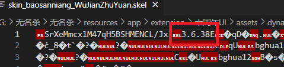
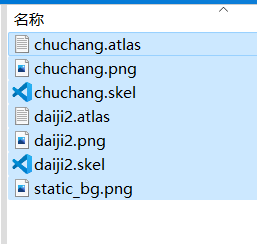
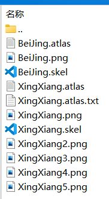
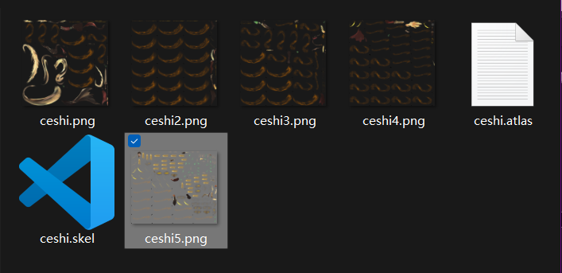
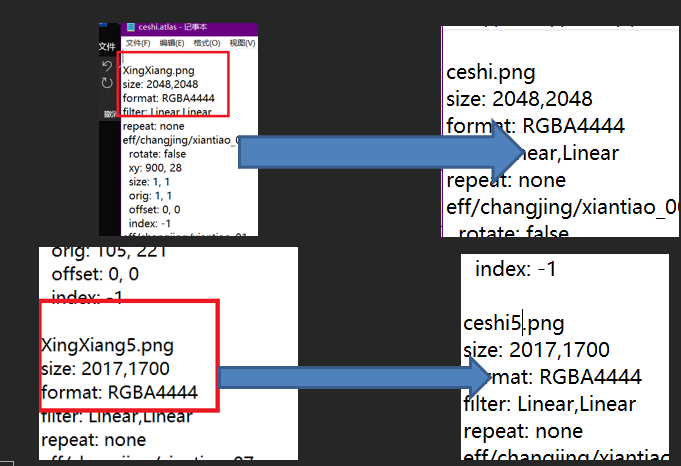
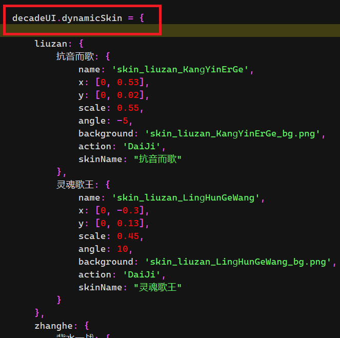
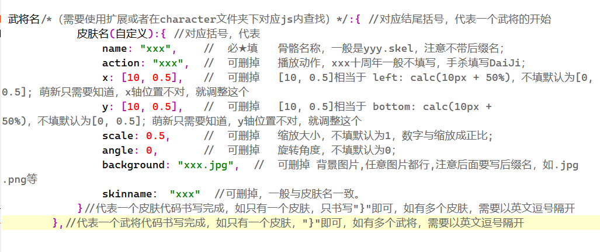
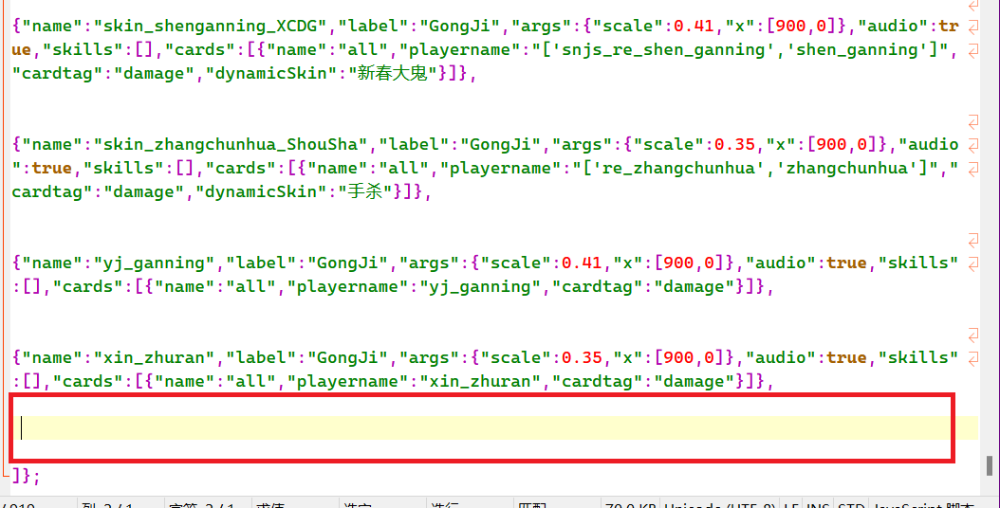

无名杀骨骼添加教程

作者：黄老板（天意不绝炎汉）

无名杀作为一个高自由度的diy游戏。扩展是游戏的精髓。

本期教程将以图文的形式简单展示如何在无名杀十周年UI扩展和特效测试扩展中添加自己所需要的骨骼。（电脑和手机方法一致）

1.  十周年UI动态皮肤骨骼添加教程

<!-- -->

1.  在游戏内通过万能导入方式安装十周年UI扩展。本部分不做详细叙述，不会的自行查找相关万能导入教程。

2.  收集需要的骨骼素材。因为种种原因，无名杀目前只支持spine软件制作的3.6.38的骨骼。一完整的骨骼应该包含三部分文件：atlas纹理文件，skel或json动作文件，png图集文件。缺少任何一个部分都会导致骨骼无法正常使用。具体查看骨骼是否版本符合步骤如下：用文本编辑软件打开任一skel文件，观察文件开头，是否有如图所示3.6.38版本号：如果存在，代表该骨骼文件符合无名杀使用条件。

3.  区分骨骼。在所有的骨骼素材中，并不是所有的骨骼都适合当做动态皮肤使用。这里以十周年和手杀为例：1、十周年武将骨骼是单一动作的骨骼，即每套文件只执行一个动作。如图所示:即为一个十周年的骨骼文件，其中chuchang代表出场，daiji代表待机，当作为动态皮肤使用时，我们一般选用daiji骨骼。（PS：daiji和daiji2同为待机，待机为十周年展示界面待机，daiji2为游戏局内待机，任取其一即可）。2、手杀骨骼，手杀骨骼是复合形态的骨骼，一套骨骼文件里包含多种动作，典型文件如图所示:同样进行翻译：beijing代表背景，一般用来裁切为背景图片；xingxiang代表形象。我们通常使用xingxiang骨骼作为人物骨骼使用。

4.  修改骨骼文件名。拿到所需要的骨骼之后，就需要对骨骼文件进行处理了。对于一般的骨骼文件，我们仅仅需要修改两处即可。这里以上述手杀骨骼为例。首先，修改所有文件名为所需要的名字，如图所示：第二步、以文本方式打开atlas文件，修改如图所示位置：（注意：对应的png有几张，则存在几个类似的名字，均需要进行修改。这里以两处为例）。修改完成后。保存文件。

5.  放置骨骼文件和书写代码。到这里为止。一切的准备工作就算已经做完了，接下来我们需要将骨骼文件放到对应的位置上并按照模板书写相应代码。第一步：在无名杀找到如下路径（extension\十周年UI\assets\dynamic）打开，复制粘贴骨骼文件这个文件夹。第二步：在“extension\十周年UI\\”下找到“dynamicSkin.js”文件，以文本方式打开。找到如图所示位置： 在 decadeUI.dynamicSkin = { 后书写需要的代码。

6.  代码解析：谨记：所有代码都讲究有头有尾，即你前面有多少个对应的括号开头，后面需要有多少个对应的括号结尾。

<!-- -->

2.  特效测试添加动态出框教程

<!-- -->

1.  添加素材；特效一般使用十周年chuchang骨骼和手杀xingxiang骨骼，同十周年处理过程，将处理好的文件放入“extension\特效测试\animation_image\TXCStexiao”文件夹下。

2.  书写代码。在“extension\特效测试\\”以文本方式打开dlc.js文件。在如图所示位置，添加代码。

3.  代码解析。以图上xin_zhuran代码为例。{"name":"xin_zhuran(骨骼素材名称，与骨骼文件名称一致)","label":"GongJi(同十周年action，手杀填GongJi，十周年不填写)", "position":"player(骨骼播放位置，常见为player：玩家武将位；screen：全屏中心)","args":{"scale":0.35(全局缩放大小),"x":\[900,0\](x轴方向参数，推荐萌新不修改后面，只修改前面即可)},"audio":true(是否有音效，true代表有，音效文件与name同名，置于extension\特效测试\spine_audio\文件夹下), "skills":\[\],"cards":\[{"name":"all","playername":"xin_zhuran(绑定武将id，id查询需借助扩展或在character文件夹下对应js代码内查询。多武将绑定采取\[‘XXX’,’XXX’,’XXX’\]的形式)","cardtag":"damage"}\],"forbid":true(禁用，true代表禁用，false代表不禁用)},
