# 无名杀怎么下载（任选其一）

1.  GitHub(可能需要翻墙)访问无名杀项目仓库：

> 网址：<https://github.com/libnoname/noname>
>
> 下载最新发布版本(的数据包)请点击“Code”，“Download ZIP”：

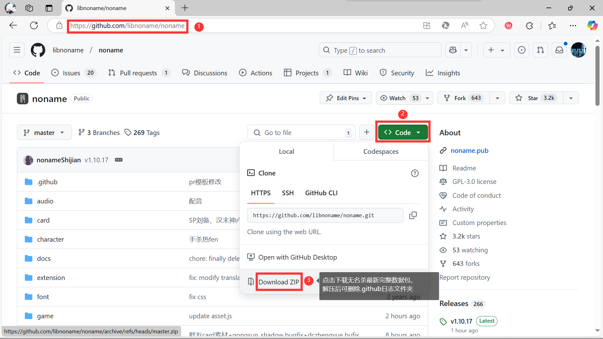

> 将下载的压缩包解压并打开(一或两次)至**有若干文件夹**的位置，参考下面安装教程进行操作；需要下载安装包（启动器）的请往下翻，在README里有客户端下载链接（形似[GitHub · 支持Chromium 91的新客户端(https://github.com/libnoname/noname/releases/tag/chromium91-client)](GitHub%20·%20支持Chromium%2091的新客户端(https://github.com/libnoname/noname/releases/tag/chromium91-client))）。请勿完全参考图示，链接可能会变更

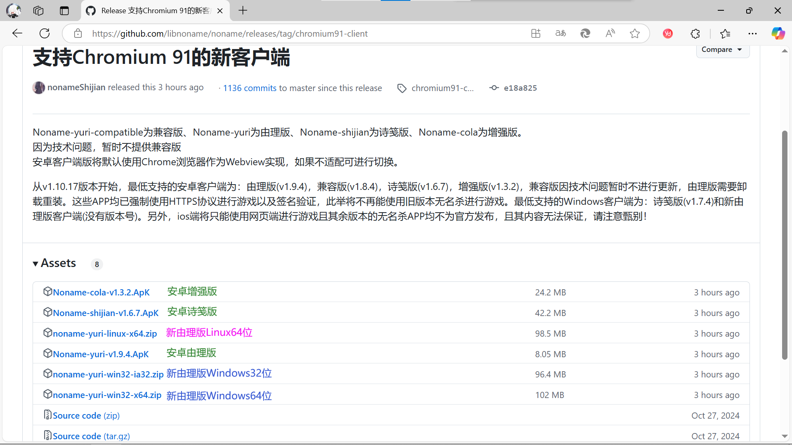

> 此外，你也可以直接在GitHub上下载最新PR(测试)版本，新手不建议尝试：

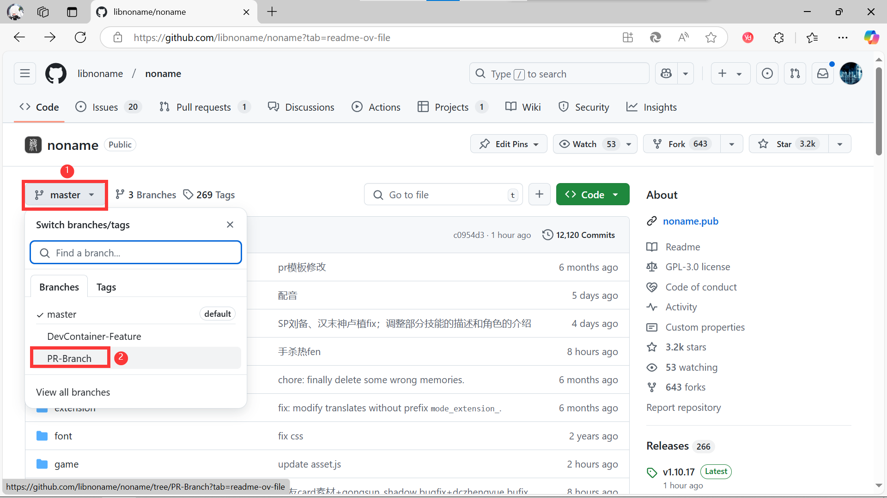

刷新到PR-Branch分支后再点击“Code”和“Download ZIP”即可。

2\. QQ频道加入“无名杀”官方频道

3.个人网盘链接：

> 123云盘：<https://www.123pan.com/s/hjYtVv-vgDyh.html>
>
> 提取码：sbqq

夸克网盘：<https://pan.quark.cn/s/97bf1dc62dd3>

无提取码

百度网盘频繁被封，故不再提供

4.加无名杀官方群（以下为群友提供）

进群问题：无名杀创始人是谁？答案：水乎

> **无名杀官方群Ⅱ：885209661\
> 无名杀官方群Ⅲ(疑似无法通过群号查找)：459406548\
> 无名杀官方IV群：833216087\
> 无名杀官方群V：784030074\
> 无名杀官方群VI：1079533768\
> 无名杀官方群Ⅶ：707344364\
> 武将diy第九交流区：693526248\
> 无名杀官方群X：729583887\
> 无名杀官方群XII：500004047\
> 无名杀官方群XIII：752253383\
> 无名杀官方群XIV：157944551\
> 无名杀官方群XV：885656146\
> 无名杀官方群XVI：699978396\
> 无名杀官方群XVIII：514420615\
> 无名杀官方群XX：565580233**
>
> **无名杀内测资源整合群（新手勿加）：1037970212**
>
> **辉烬的修仙聊天群（新手勿加）：616680578**

# Bug在哪儿反馈

1.  百度贴吧无名杀吧bug反馈帖（置顶帖）

> **无名杀吧置顶帖**：<https://tieba.baidu.com/p/9117747182>

2.  直接提交到GitHub上

> 如果您会使用GitHub的话，更推荐您直接在无名杀开源项目<https://github.com/libnoname/noname>上提issue，当然如果您会写代码的话亦可自己修改并pr（请提到PR-Branch分支）。

3.  Bug反馈/测试群

> **无名杀本体更新内测群：392157644**
>
> **无名杀鼠鼠群：872800679**
>
> 若反馈的bug已经得到解决且你不参与后续测试反馈工作的话，请自行退群给其他需要反馈bug的人留空。

4.  扩展引起的bug请加相应扩展交流群

> 一般会写在扩展设置界面，此处提供几个常用扩展的群聊：
>
> **无名杀十周年&皮切扩展1群：985914900**
>
> **无名杀十周年&皮切扩展2群：310754539**
>
> **无名杀千幻聆音样式群：732833896**
>
> **无名杀千幻聆音内测群：1050143594**
>
> **无名杀无名美化扩展群：239077053**
>
> **无名杀手杀露头群：1046133054**
>
> **无名杀活动武将扩展群：346854437**

# 名词解释：

**启动器/安装包：**运行无名杀的程序。安卓端.apk，Windows端.exe等。像Windows和Linux程序一般打包在压缩包内

**离线/增量(数据)包：**无名杀运行必需的数据包+该版本较上一版本新增的（注意是和上一个发布版本对比）素材文件。导入它后就可以开始玩无名杀，但它缺少上版本之前的所有素材。一般都是相邻版本更新用。比如v1.10.17.3的增量包就是v1.10.17.2~v1.10.17.3新增的内容打包。

**完整(数据)包：**无名杀的所有数据内容。第一次安装请导入完整包（除非安装包内置了）。如果你不嫌麻烦，完全可以每次都导入完整包。

**扩展：**只能在无名杀中使用的杀友自制的衍生内容。通常是压缩包格式，里面有extension.js文件。最常见的就是武将扩展，用来扩充一些本体没有的官方/自制武将包；此外还有美化扩展、功能扩展等，导入规则一致。

扩展导入与完整包/离线包导入方式相同，小概率会失败。

如果导入失败（扩展里没有）请在菜单→选项→扩展→制作扩展内新建同名扩展并保存，然后手动解压覆盖到extension对应扩展目录下，注意让extension.js文件所在层覆盖到extension/扩展名/所在层。

**本体目录：**指无名杀的数据路径，安卓端一般是Andriod/data/{无名杀程序包名}/下，Windows端则取决于你将无名杀放在了哪里，不过Windows端大部分操作都在{你放的路径}/resources/app/下。所谓“万能导入法”宗旨就是直接在目录下进行操作，完整包/离线包覆盖便是在上述路径下解压直接覆盖替换。

安卓端无名杀本体路径：

> 诗笺版：Android/data/com.noname.shijian/
>
> 由理版：Android/data/yuri.nakamura.noname_android/
>
> 增强版：Android/data/com.widget.noname.cola/{日期}/
>
> 由理兼容版：Android/data/yuri.nakamura.noname/

**素材包：**一般是大量武将皮肤和皮肤语音（也可能二者分开压缩）的压缩包，由于本体不内置皮肤素材，即使自行添加相应的功能也十分单一，故目前比较流行的都是需要借助如《千幻聆音》之类的扩展**才能使用**的打包格式。

使用此类素材包之前请按照分享者提供的方法操作，如其强调类似“千幻用”“皮切”“十周年用”等，请提前下载导入对应扩展再操作，否则后果自负。

**UI：**指《十周年UI》《魔改十周年UI》《界面美化》这类美化界面/卡牌/布局等样式的功能扩展，一般此类扩展会修改大量底层代码，（报错一般会告知是哪些地方的调用出了问题。但是由于UI扩展动了底层代码，导致可能不是它的问题但被它所掩盖；此外一般UI扩展不支持联机，如果联机出了问题请先关闭UI扩展）因此**一旦**本体对底层函数进行改进升级或废弃，此类扩展也**极有可能**失效或报错。也同样因为这个原因，如果出现的弹窗内容里包含此类扩展名，请关闭此类扩展以作进一步排查。

**内核（Chromium）：**由于无名杀是靠浏览器驱动的(似乎不太准确，先这样理解吧)，所以对浏览器内核版本有要求。

如果你在安装的时候游戏弹窗进不去，请留意是不是内核版本的问题。具体表现和**解决方法**见第27页

安卓系统一般取决于系统自带的WebView版本(第一个小数点前面的数)，一般越新发布的手机内核版本越高；Windows系统则默认使用Edge浏览器版本；iOS系统只需要升级系统即可。此外安卓也可以通过安装使用Chromium内核的浏览器来代替本体WebView版本。优先级方面兼容版内核 \> Chromium浏览器内核 \> WebView

目前最新版本要求的内核为：Chromium 91及以上（iOS系统暂不支持）

# 安卓端安装教程

**适用范围：**安卓系统（除苹果、纯血鸿蒙外的绝大多数智能手机或平板）

**安装包（apk后缀，不区分大小写）：**

> 无名杀诗笺版v1.6.7及以上、
>
> 无名杀由理版v1.9.4及以上、
>
> 无名杀增强版v1.3.2及以上、
>
> 无名杀由理兼容版v1.8.4及以上（仅限安卓15以下）

## 安装步骤：（不会的问百度，后同）

### 安装无名杀（略），最好打开一下（什么都不用干）然后退出

提示：

1.  安装包在哪里？

    取决于你下载的位置。如果你是从QQ群里下载的，可以直接点击下载好的安装包或者压缩包，正中央或者右上角三个点里有“用其他应用打开”相关的功能。当然安装包可以直接点击安装；数据包和扩展就需要用无名杀打开了（仅限安卓端），电脑端或没有此功能的话请跳转/打开对应目录参考教程后续内容进行操作。

2.  常用路径（自己设置过的/电脑端请自行查找）

    安卓端： /storage/emulated/0/是在没有ROOT时你通过文件管理器能直接访问的最上级的路径，一般描述中会省略

    QQ下载文件路径：/storage/emulated/0/Android/data/com.tencent.mobileqq/Tencent/QQfile_recv/

    百度网盘下载文件路径：/storage/emulated/0/Download/BaiduNetdisk/

    夸克网盘下载文件路径：/storage/emulated/0/Download/QuarkDownloads/CloudDrive/

    123云盘下载文件路径：/storage/emulated/0/123云盘/

### 导入完整包/离线包（方法一样，扩展也是）内置完整包的版本请按照程序提示加载内置资源包！跳过此步骤

如果你是用网盘下载的，建议使用第三方文件管理器（MT管理器、ES文件浏览器等）找到文件（不知道下载目录直接百度）长按更多（大致这个意思，可能是别的显示效果），用其他应用打开，然后就可以按照第三张图后面流程操作了。

该步骤**关键在于**找到要导入的数据包/扩展，然后用无名杀的外置导入功能导入压缩包

但是！它可能由于种种原因无法通过此法导入。那就需要**<u>万能导入法</u>**了：

👇

如果你懂得文件管理的话，也可以用最传统有效的方法（<u>文件目录操作</u>）：

更详细的万能导入法请看第22~25页

**扩展**要先在菜单→选项→扩展→制作扩展把扩展名填上，确定并保存；

扩展名请解压查看extension.js里第一个name: “xxx”，xxx即为扩展名。引号也可能是单引号，冒号右侧也可能没有空格。

参看上面的路径，打开你所用的无名杀对应路径。如果是数据包，解压并覆盖里面若干个同名文件/文件夹；如果是扩展，再打开extension文件夹，打开扩展名对应的文件夹，解压并覆盖里面所有文件。

数据包这样覆盖： 扩展这样覆盖：

（对应目录下所有文件和文件夹都移动替换过去）

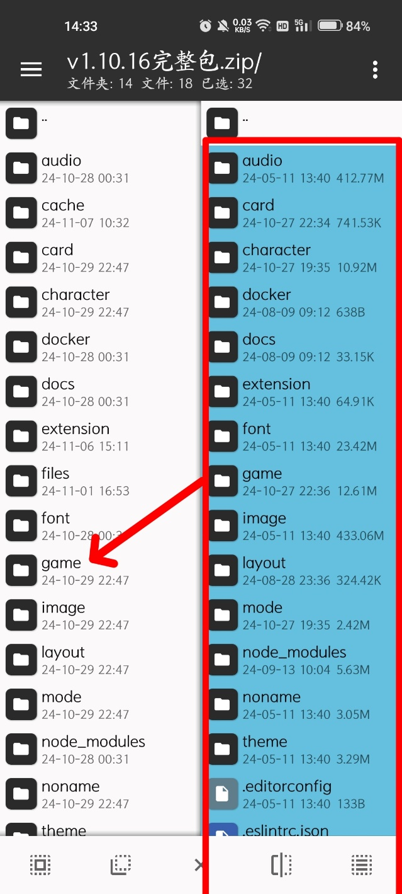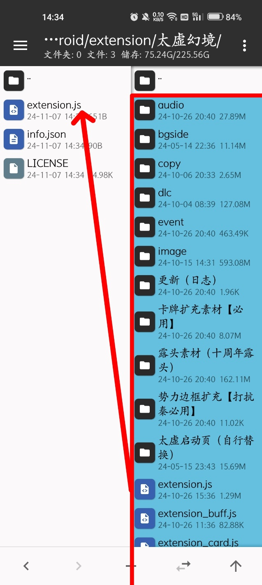

请保证(数据包)game覆盖game，(扩展)extension.js覆盖extension.js对齐路径

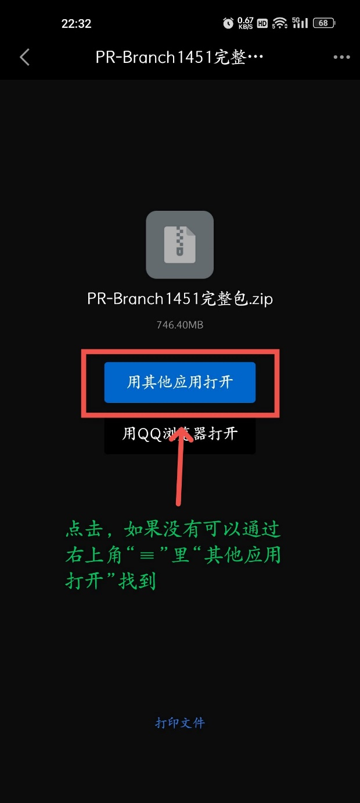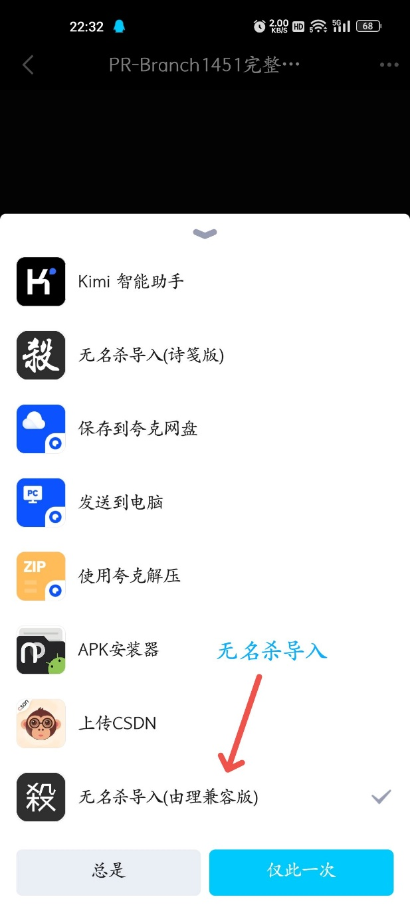

导入完整包/离线包/扩展均只需要“无名杀导入”即可

若遇到弹窗请求跳转/访问无名杀/授权访问存储空间等，请允许跳转/访问/授权。

解压时请耐心等待。如解压失败请到文件管理器内自行解压到有若干文件/文件夹的地方再压缩，然后再用无名杀导入尝试。

### 第一次导入需要干的事（之后导入没有这些弹窗）

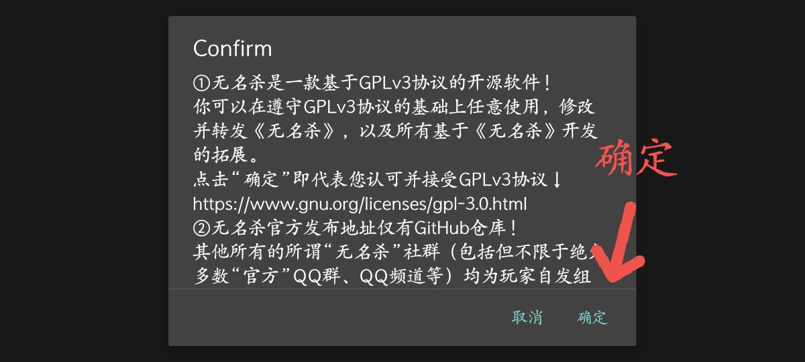

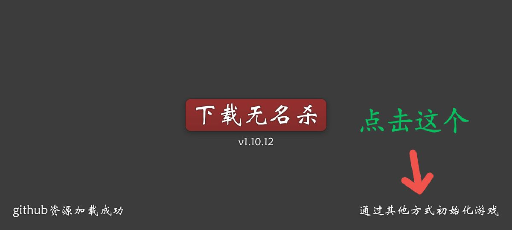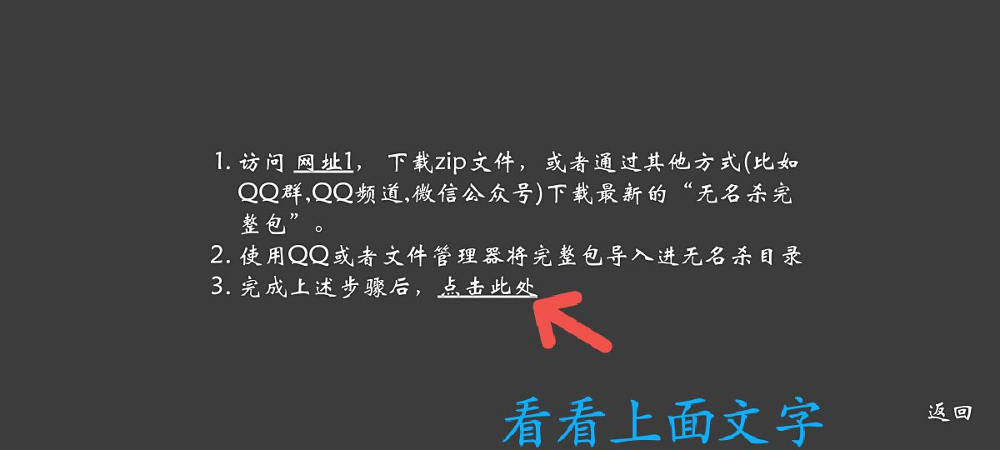

新手向导点哪个都行。

至此，由理版已经可以正常游玩了。

如果大部分武将都没有图片请导入完整包！

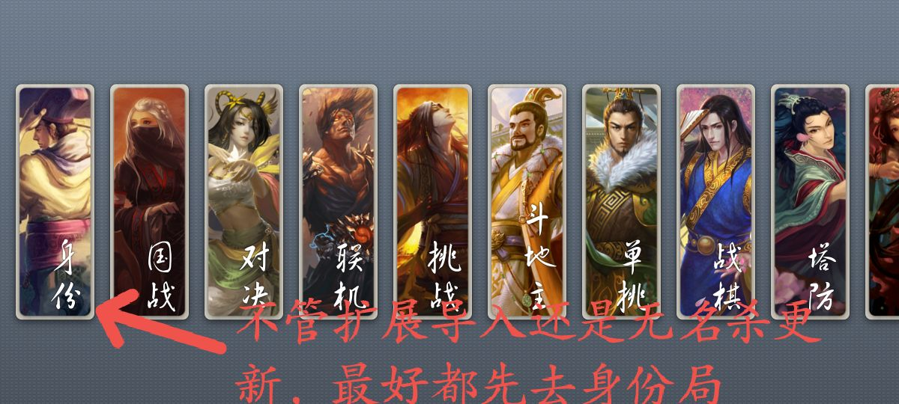

下面是诗笺版的额外操作：

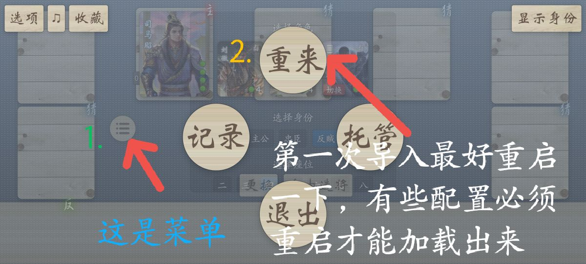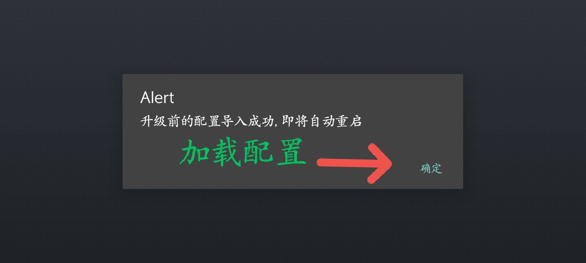

这时候可能会弹出第一次安装时遇到的界面，**请勿操作**，耐心等待几秒。

然后就可以畅玩了。没有提示配置一般也不影响正常游玩

增强版暂不支持无名杀导入且安装教程不太一样，请咨询其他玩家。

# Windows端安装教程

**适用范围：**Windows系统（除ios外的大多数电脑）

**可选无名杀程序包（zip后缀）：**

> 无名杀Windows诗笺版v1.74及以上、
>
> 无名杀Windows新由理版

**快捷导航：**数据包导入p.16、p.17，扩展导入p.19、p.20

## 安装教程（下面以诗笺版举例，其他版本更简易所以会少一些步骤，直接往后看即可）

下面教程是放在了D:\noname\下，你在操作中将此前缀<u>改为你放的路径</u>参照即可

近几年出的电脑直接选64位版本的安装包，用不了系统会提示的

### 解压无名杀程序到你能找到的位置（或者创建快捷方式）

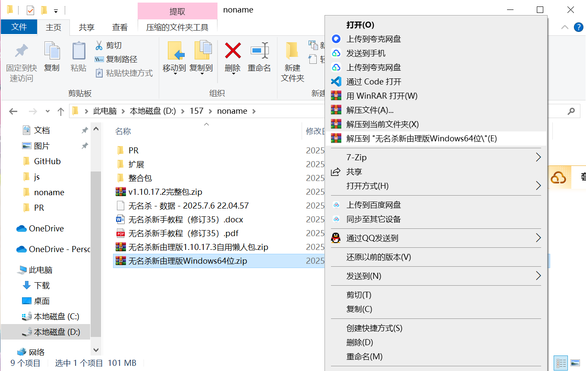

最外层文件夹可以改名，请务必保证路径中不包含空格！

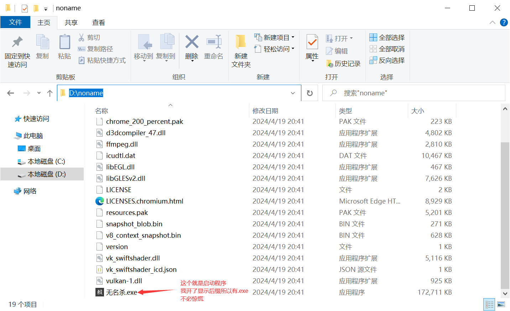

### 离线包/完整包导入通用方法

解压完整包并覆盖到本体目录(无名杀.exe所在目录)下resources/app/内。第一次导入时内置完整包的可以直接跳过此步骤

打开无名杀本体目录，找到resources/app/。大致长这样：

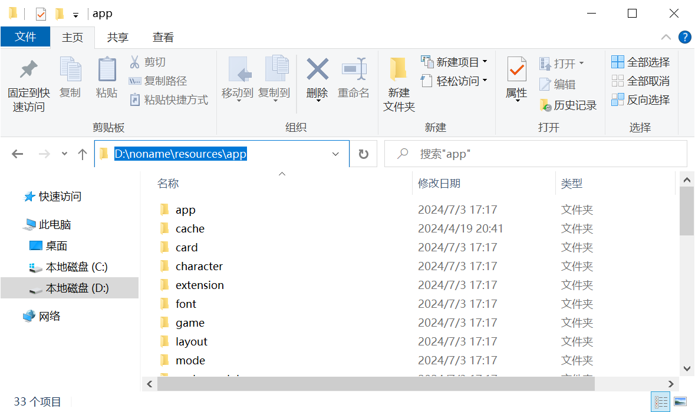

解压完整包并打开，保证打开的位置跟上面有很多同名文件夹

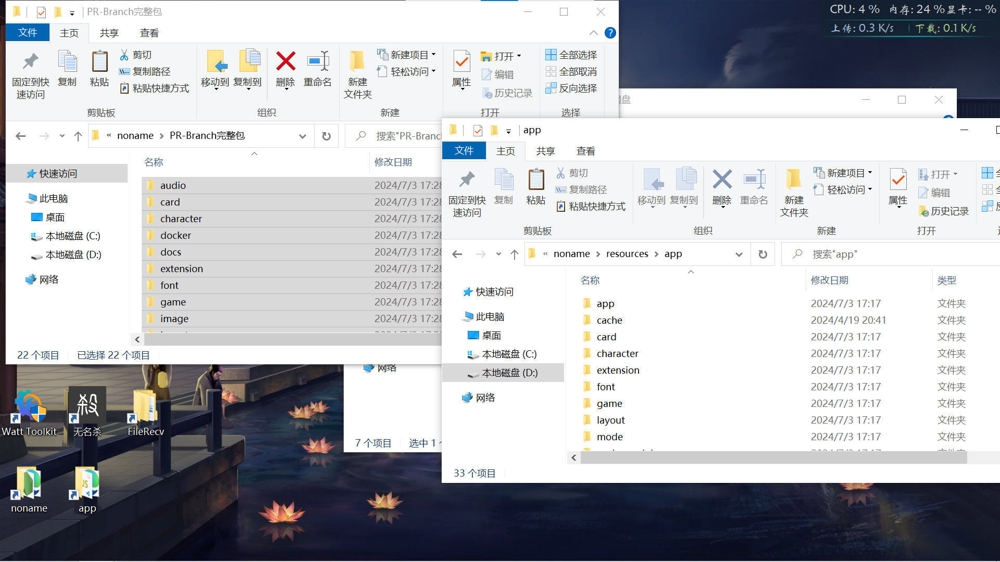

全选完整包内的文件，复制/剪切 然后粘贴到无名杀的数据路径内（刚才那个位置），覆盖/替换原有文件

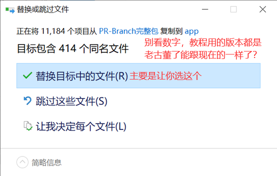

### 无名杀初始化

双击运行无名杀本体目录下的“无名杀.exe”程序

非诗笺版本此时中央会有“连接失败”或者“下载无名杀”，这个不太稳定不推荐，建议按上面的导入完整包。点击右下角“无法在线下载”，第3步有“点击此处”，已经放好数据包的就能直接正常游戏了。下面是诗笺版的操作以及扩展导入：

初始化（确定/同意，此处略过），这个和新手向导非诗笺版也有，不过没有什么需要特别注意的操作。

如果黑屏请耐心等待十几秒，一般只有初始化无名杀会遇到这种情况；如果出现下面弹窗，请点“取消”继续等待。

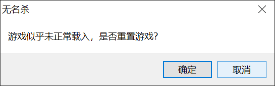

新手向导随意

取消下载素材，完整包已经包括了，并且这个下载非常慢还经常连接不上

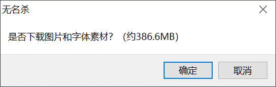

然后点左上角的“选项”，然后点那个圆圆的“启”；关闭游戏重开亦可。总之是要让无名杀重启一下。

*安卓端需要点“菜单”（屏幕靠中的小球）来唤出选项*

如果出现下面图示，请允许访问

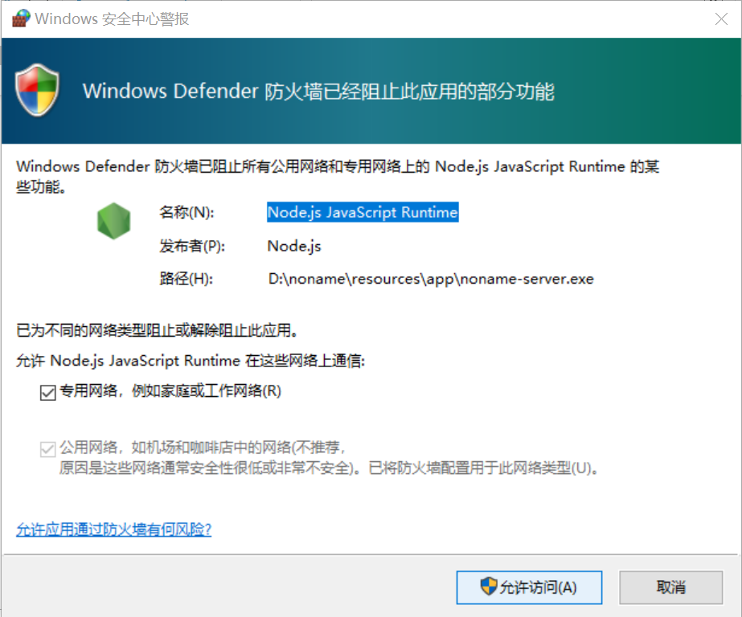诗笺版等待数秒后会弹出此内容，表示默认配置已成功载入，确定等待重启即可

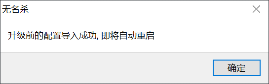

进入身份局选项查看扩展，若有《应用配置》和《拖拽读取》即说明初始化完成（非诗笺版并未内置这些扩展，没有属于正常现象）

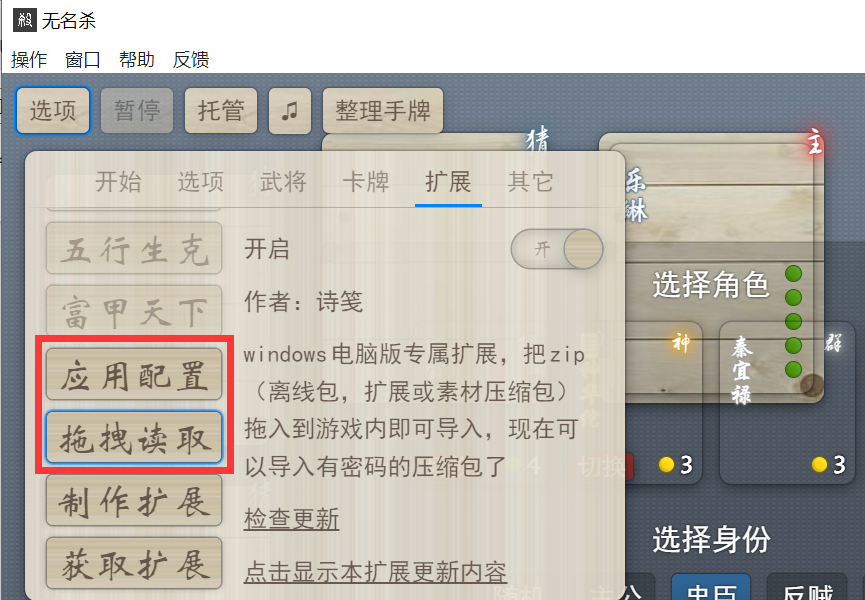

### 通用扩展导入方法

打开无名杀，进入身份模式（很多模式都可以，本教程默认都采用此方案），打开选项→扩展→制作扩展，在输入框内输入扩展名，确定并保存，不要着急重启

打开无名杀本体目录下resources/app/extension，找到对应扩展名目录打开；另外找到你找的扩展，解压并打开**到**有“extension.js”文件的目录下，全选复制/剪切 过去并覆盖

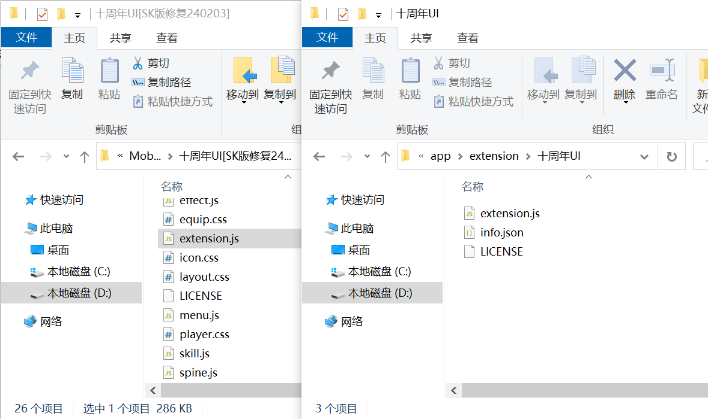

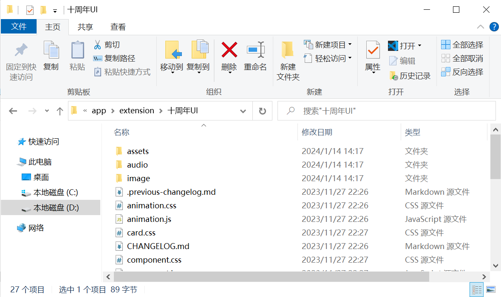

然后点击“重启”（关无名杀重新打开也可以），打开选项→扩展，如果看到对应扩展名赫然在列并且点开后右侧显示的不是无名玩家 or 有扩展介绍（一般作者应该不会取默认的“无名玩家”吧？）就说明导入成功

提示一下，扩展武将包/卡牌包一般需要自己去武将/卡牌那儿**手动开启**，同理需要重启后生效

# 新手须知

## 不要使用游戏内自带的任何更新功能！

游戏内置更新功能连接的服务器非常不稳定！一旦中途更新中断**极易**因游戏内部分文件使用了下载失败的文件**导致游戏崩溃！**然后你就喜提卸载重装游戏了（所有配置都会丢失！）

## 游戏报错基本处理步骤：

遇到报错弹窗请第一时间把**弹窗全部信息**都截图/**保存下来**。最好把场上情况再截图/保存一下并记住谁正在干什么报的错。

如果这是进入游戏时报的错且：

是在<u>安装过程中</u>遇到的，请查看有无“浏览器”“UA”“版本过低”之类的字样，如是请按照第27页“内核版本过低”的问题处理；

是在<u>导入扩展后</u>遇到的，一般是扩展不适配或导入了有bug的扩展导致的。请到无名杀本体目录下/extension/删除对应扩展名文件夹；

是在<u>导入数据包/测试包后</u>遇到的，请再导入之前的一个稳定版本的离线包（完整包亦可）覆盖有问题的数据包；

如果这是在游玩过程中报的错，请关闭所有扩展并重启游戏观察。若仍有bug请在相关渠道进行反馈；否则逐个开启**单一扩展**排查引起bug的扩展，遇到弹窗后同上完整截图并联系扩展作者反馈扩展bug。如果联系不到且点确定后游戏仍能进行，也可以无视bug继续游玩；当然还是建议关闭此扩展。严重影响正常游戏的请卸载重装

## 扩展名怎么查

解压扩展，往里找extension.js，打开（文档形式即可）在里面找第一个“name:”，它右端的引号(无所谓单双引号)里的内容就是扩展名。

## 导入数据包/扩展的方法

在下面

## 更新前请先备份数据（尤其是美化扩展重度玩家）

选项→选项→其它→导出游戏设置

# 万能导入法(文件目录操作)

## 必须掌握的知识：（自行百度）

什么是文件路径？

什么是相对路径？

怎么找到指定路径？

复制、粘贴、剪切文件都是什么意思？

怎么复制/剪切/粘贴文件？

覆盖文件是什么意思？

我要导入的扩展/数据包在哪里？

怎么压缩/解压？

## 常用路径如下：

安卓系统会多一个这样的前缀：/storage/emulated/0/

这是在没有ROOT时你通过文件管理器能直接访问的最上级的路径，一般描述中可能**省略**或写成“系统/”“本地目录/”等，共同点就是你不能再往上追溯。

QQ下载文件路径：/storage/emulated/0/Android/data/com.tencent.mobileqq/Tencent/QQfile_recv/

百度网盘下载文件路径：/storage/emulated/0/Download/BaiduNetdisk/

夸克网盘下载文件路径：/storage/emulated/0/Download/QuarkDownloads/CloudDrive/

123云盘下载文件路径：/storage/emulated/0/123云盘/

### 下面是网盘目前还有效的绕过限速的机制，日后失效也正常

#### 夸克网盘

将文件转存到夸克网盘后，下载电脑端和手机端的夸克（夸克网盘未试过），右键/长按要下载的文件或文件夹，选择“发送到电脑/手机”，即可在另一端的快传里快速下载。

## 手机端看这里（以安卓为主，其他系统自行参悟）：

**扩展一定要**先在菜单→选项→扩展→制作扩展把扩展名填上，确定并保存；

扩展名怎么查看上面须知。

参看上面提供的路径，打开你使用的无名杀对应的路径。如果是数据包，解压并覆盖里面若干个同名文件/文件夹；如果是扩展，再打开extension文件夹，打开扩展名对应的文件夹，解压并覆盖里面所有文件。

数据包这样覆盖： 扩展这样覆盖：

（对应目录下所有文件和文件夹都移动替换过去）

素材请按照分享者给的说明放到对应位置。

注意！是把你要导入的东西解压并替换原有的，而不是把原有的弄出来

如果你的系统版本过高可能会出现不允许你对应用数据路径操作的情况，那建议还是用无名杀导入；如果你要导入的是素材且：

素材路径应放在无名杀本体目录/image/skin/下，请找个你用的无名杀版本的离线包（完整包亦可，就是慢了些）解压，把素材移动到解压的数据包里/image/skin/(没有就新建对应文件夹)下，然后回到image的上一级目录进行压缩，再通过无名杀导入；

素材路径应放在无名杀本体目录/extension/{某个扩展目录下的某个位置}下，那就找到这个扩展（没有？自己再找一个），类似上面，把素材移动到相对路径下，然后回到extension.js所在目录下打包压缩再用无名杀导入。如果你已经导入过这个扩展，只需保留extension.js和素材相对关系，其余都可以删掉，打包压缩导入

无论是什么端都遵循一条原则：

保证(数据包)game文件夹覆盖game文件夹 / (扩展)extension.js覆盖extension.js的前提下对齐路径覆盖（替换）原来的

## 电脑端去看Windows安装教程

这要还看不懂那只能建议不要玩扩展和美化了

# 新手答疑/问题补充

## 有好多我理解不了的词汇

看不懂的请百度或问大语言模型。常识问题先自行搜索进行电子扫盲

## 这些安装包（客户端）都有什么区别？

诗笺版是更新最快的版本，内置了很多适合开发者使用的功能，同时也很方便人们去制作懒人包；

由理版简单纯粹，啥也不带；

由理兼容版是为了兼容低内核设备的，如果你安装别的客户端（安装包）进去弹窗“您使用的浏览器或《无名杀》客户端加载内容失败！”等字样，一般就是系统内核(WebView)太低导致的，安卓可以使用该版本对付，下一页提供了更多解决方案；

增强版支持多套无名杀本体共存、支持开服务器(局域网)，以及其他额外功能；

懒人包请看发布/分享者给的介绍；

如果是“清瑶版”“清梨版”，那是打着<u>无名杀十周年</u>旗号自划地的一些玩家做的，无法使用最新版本和一些扩展，如果你满足于此那就不需要看此文档了；

其他的貌似木有了

## 浏览器<u>内核版本过低</u>是什么意思？如何解决？

(1)浏览器内核一般是手机系统预置的，存在不及时性。老旧机型更明显，毕竟可能当时浏览器内核最新的版本也没有达到无名杀要求的版本。

(2)以下都是解决方法，任意执行其中一种即可（都执行也不会出问题）

1.安卓端可换成由理兼容版，Windows端可更新Edge浏览器

2.额外安装一个最新版本的Chrome浏览器，无名杀会使用该浏览器的版本作为内核

3.自行查找自己设备如何更新Android System WebView进行更新

苹果端取决于系统版本，请升级系统

## 电脑上必须放在D盘吗？

这个随意，看个人喜好，你能找到就行

## 为什么我手机上能导入的东西，电脑上导入不了？

数据包请直接覆盖无名杀/resources/app/（覆盖替换可以，不要删原有的），具体参考第16~17页

扩展包请按照第19~20页【通用扩展导入方法】导入

## 我现在用的是1.10.XX，离最新版本差了好几个版本，需要一层一层往上更新吗

**不需要**。但建议直接导入最新完整包，不要用离线包。

## 为什么我装了最新的完整包，还是有些武将没有图片？

首先，请查看官方有没有出这些（画饼）武将的原画，没有我们也变不出来；

如果有，请加我的群把素材发给我（缺失的语音素材亦同）我去GitHub提，当然如果你会弄的话，自己去GitHub提也行

## 素材包/XX扩展在哪儿找啊

个人只用本体和好友自制的扩展，这些建议去b站、QQ频道、Q群等玩家集结地问

## 素材包怎么用？

我不用素材美化那些，所以不要问我。但有一点是明确的，你大概率要解压然后万能导入，有些好心的分享者会把要导入的路径等说明放在压缩包里面，照做即可。没有？那就问问其他玩家吧。我知道的也只有《千幻聆音》的皮肤、台词、原画、露头分别放在无名杀本体目录下extension/千幻聆音/sanguoskin、无名杀本体目录下extension/千幻聆音/sanguoaudio、(前面略)/sanguoyuanhua、（前面略）/sanguolutouskin；骨骼特效得用《十周年UI》和《皮肤切换》。

## 有2v2、3v3这些模式吗？

请在选项→开始→对决→游戏模式中选择“欢乐”“统帅”等，点下方的“启”或者重启游戏再去对应模式即可体验，其他细分的模式同理查找

## 我看他们都说无名杀能联机，我咋没找到啊

方法一：关掉游戏再重进：

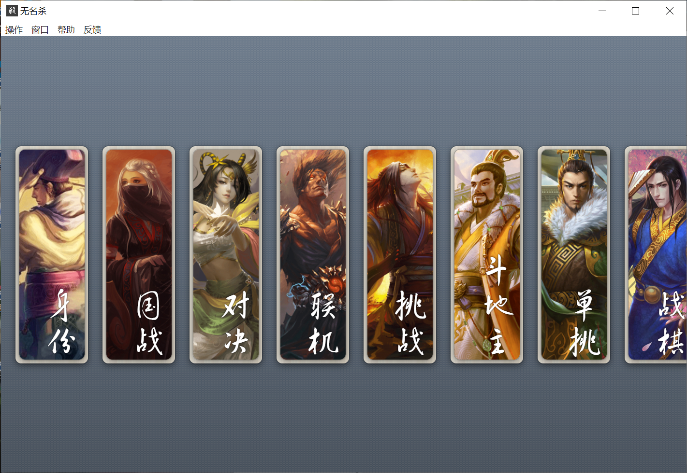

方法二：打开菜单：

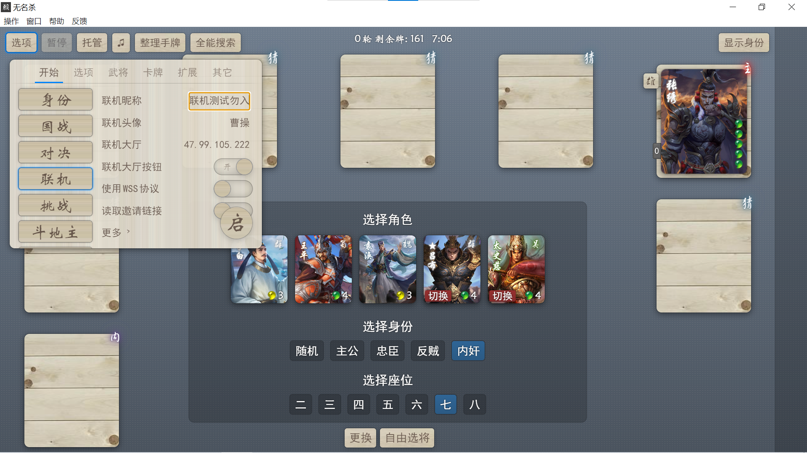

手勤点，不要让嘴总比脑子快

## 为什么我进不了联机模式？

确保游戏是最新版本后多试几次。

如果是官方大厅，不要用群里的PR版本。如果已经导入了，再导入一次最新的发布版本数据包即可

## 为什么我一进联机扩展就没了？

为防止有人再如之前那样恶意攻击服务器，官方服务器是禁用扩展的。想玩扩展请找大佬搭的私服或者自己搭一个

## 为什么我和别人联机一直报错，我单机的时候扩展也没报错啊

请先确保房间内所有人游戏版本以及开启的扩展都是一致的

## 我不需要素材，只导入离线包行不？

Nb啊，当然可以啊

## 为什么不直接看录像文件？这样排查不是更清楚么？

1.  需要找你所说的报错位置，有时候回放因为省去了一些东西会另外报错，也有可能略过要排查的错误；

2.  回放本身也有一些问题；

3.  即使避免了上述问题，也有可能因为反馈者和排查者使用的游戏版本不同、机型不同、开启的扩展不同等种种原因导致无法复现bug；

4.  录像文件也不利于传输，除非你与bug受理者有能发送此类文件的沟通渠道

因此，不推荐使用录像作为排查bug的主要手段。

## 兼容版 / XX版一直闪退

目前兼容版因技术问题无法支持安卓15系统，此外经不完全统计部分特定机型也无法正常游玩某个版本，请尝试安装其他版本。都不行那就没办法了

### 其他交流群

1.  联机交流群

> **无名杀官方联机群（無銘）：367932654\
> 无名杀私服联机群（守望）：965239885\
> 无名杀私服联机群（无三）：596652800**
>
> 私服：43.138.118.130（43服，服主无三，维护守望）
>
> 私服：49.233.171.97（49服，服主守望）
>
> 私服：n.stlux.art（st服，服主路克斯X奥维尔）
>
> 注意关闭扩展再联机，或者表明有什么扩展，一些扩展会崩房间。如需联机请更换可用的联机地址，建议多加几个联机群方便打牌

2.  代码交流群

> **无名杀频道代码萌新群：698319604**

3.  懒人包群

> **无名杀辉烬懒人包群：616680578\
> 无名杀琉璃懒人包群：623260187\
> 无名杀棘手懒人包群：725233902**
>
> 其他群聊、链接等请看无名杀群聊、链接等.md
